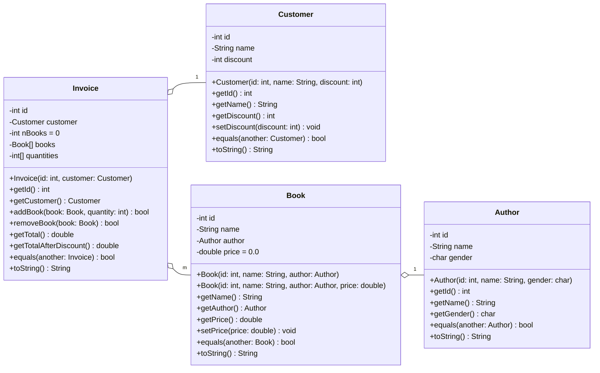

# Diagrama de classes

A fatura agrega o cliente e os livros comprados, e cada livro agrega o seu autor. O GitHub desenha o diagrama abaixo a partir do texto.

| Classe | Formato do `toString` | Observação |
|---|---|---|
| `Invoice` | `Invoice[id = ?, Customer[id = ?, name = ?, discount = ?], total = ?]` | O total já sai com o desconto. `addBook` devolve `false` se o livro já estiver na fatura, e `removeBook`, se ele não estiver. |
| `Customer` | `Customer[id = ?, name = ?, discount = ?]` | O desconto é um percentual de 0 a 100. |
| `Book` | `Book[name = ?, Author[name = ?, gender = ?], price = ?]` | O título é guardado com até 63 bytes. |
| `Author` | `Author[name = ?, gender = ?]` | O gênero vale `M` ou `F`. |
